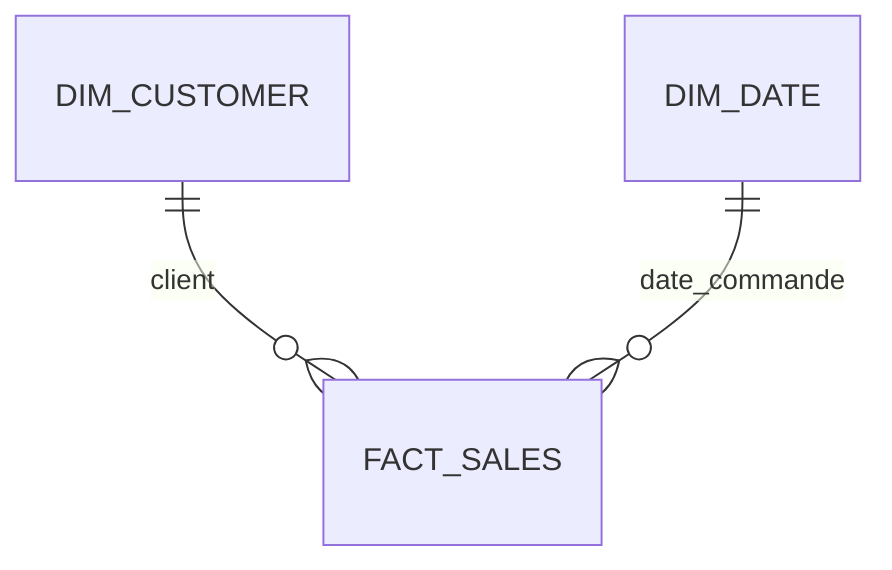
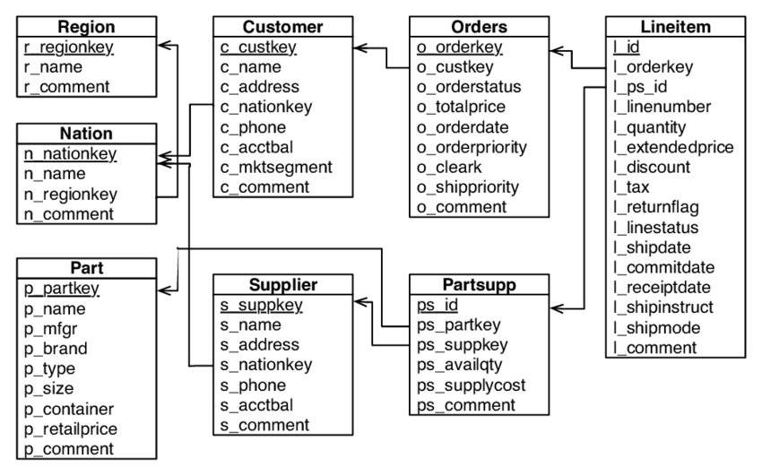

# Data Engineer Interview Test — Solution Python et SQL

Cette solution charge quatre fichiers sources dans SQLite, alimente un schéma en étoile et répond aux cinq questions métier de l'énoncé. Les deux exercices Python sont également réalisés. Le pipeline s'exécute sur une machine Linux ; les rapports se consultent dans le navigateur avec Datasette ou en CSV.

## 1. Prérequis

- Python 3.12 avec `venv` et SQLite embarqué version 3.37 ou supérieure.
- Bash et `flock` (util-linux) pour le lanceur planifiable.
- Accès au registre Python pour installer les dépendances de `requirements.txt`.

Le chargement et l'export utilisent uniquement la bibliothèque standard Python. Datasette fournit l'interface de consultation et pytest les tests. Aucun serveur de base de données n'est nécessaire.

## 2. Installer et exécuter

Depuis la racine d'une copie du projet :

```bash
python3.12 -m venv .venv
source .venv/bin/activate
python -m pip install -r requirements.txt
python -m pip check
python -c 'import sqlite3; print(sqlite3.sqlite_version); assert sqlite3.sqlite_version_info >= (3, 37, 0)'
python -m pytest -q tests
bash scripts/run_pipeline.sh
```

Le dossier `data/` contient les données fournies. S'il est absent, le recréer depuis l'archive de l'énoncé avec `python -m zipfile -e data.zip data`.

Le lanceur affiche le chemin du journal quotidien dans `logs/`, puis y inscrit les volumes et le résultat. Il charge la base `outputs/warehouse.sqlite`, exporte sept CSV dans `outputs/` et empêche les exécutions simultanées sur la même base. Pour suivre une exécution, ouvrir le journal indiqué. Un code de sortie `0` signifie succès ; `75` signifie qu'une autre exécution détient le verrou.

Pour exécuter les deux étapes séparément, par exemple en développement :

```bash
python -m etl.load_sources --data-dir data --database outputs/warehouse.sqlite
python -m etl.export_reports --database outputs/warehouse.sqlite --output-dir outputs
```

Ces commandes directes ne prennent pas le verrou du lanceur. Les chemins par défaut sont calculés depuis le code ; les arguments explicites sont relatifs au dossier courant. En exploitation, utiliser le lanceur et un lot complet dont les fichiers restent stables pendant le chargement.

## 3. Consulter les résultats

```bash
datasette serve outputs/warehouse.sqlite --host 127.0.0.1 --port 8001
```

Ouvrir [la base](http://127.0.0.1:8001/warehouse), puis une table ou une vue. Le [rapport mensuel](http://127.0.0.1:8001/warehouse/monthly_sales?_sort=period&_size=max) contient 80 mois avec le jeu fourni. Arrêter le serveur avec Ctrl+C.

| Question | Vue SQL | Export dans `outputs/` |
| --- | --- | --- |
| Top 5 des pays par revenu | `top_5_nations` | `top_5_nations.csv` |
| Transport le plus fréquent parmi ces pays | `top_shipping_modes` | `top_shipping_modes.csv` |
| Meilleurs mois | `best_sales_months` | `best_sales_months.csv` |
| Meilleurs clients par revenu | `customers_by_revenue` | `customers_by_revenue.csv` |
| Meilleurs clients par quantité | `customers_by_quantity` | `customers_by_quantity.csv` |
| Période courante contre précédente | `period_comparison` | `period_comparison.csv` |
| Rapport mensuel chronologique | `monthly_sales` | `monthly_sales.csv` |

Dans l'éditeur SQL de Datasette, utiliser par exemple `SELECT * FROM monthly_sales ORDER BY period;`. Les rapports et leurs résultats détaillés sont expliqués dans le [guide métier](docs/README_ETAPE_7.md).

## 4. Sources et modèle

Les fichiers `.tbl` sont du texte ASCII sans en-tête, séparé par `|`, avec un séparateur final. Les nombres décimaux utilisent le point et les dates le format `AAAA-MM-JJ`. Le DDL original et l'ERD sont conservés dans `ddl.sql` et `erd.png` ; le SQL exécuté est dans `sql/`.

| Table chargée | Nombre de lignes attendu |
| --- | ---: |
| `nation` | 25 |
| `customer` | 1 500 |
| `orders` | 15 000 |
| `lineitem` | 60 175 |
| `dim_customer` | 1 500 |
| `dim_date` | 2 406 |
| `fact_sales` | 60 175 |

Ces volumes décrivent le jeu fourni ; le parseur ne les impose pas aux autres lots. Les huit fichiers ont été explorés, mais seules les quatre sources nécessaires à ce périmètre sont chargées. Les références aux produits, fournisseurs et régions ne sont pas contrôlées dans la base livrée.



Un fait représente une ligne de commande, avec la clé `(order_id, line_number)`. La dimension client conserve tous les clients et leur pays, y compris les 500 sans commande. Le calendrier contient tous les jours entre la première et la dernière date de commande. Le [modèle détaillé et les règles métier](docs/README_ETAPE_3.md) expliquent les colonnes et les relations.

## 5. Règles de calcul et relance

Le revenu est le prix étendu après remise, hors taxe. Le prix étendu inclut déjà la quantité. Les montants sont stockés en centimes entiers et la remise en pourcentage entier ; chaque ligne est arrondie au centime avec `ROUND_HALF_UP` avant la somme. Toutes les lignes sont incluses sans filtre sur les statuts ou retours. Aucune devise n'est définie par les sources.

Les ventes sont rattachées à la date de commande et regroupées par année-mois. Le mois de la date maximale est signalé comme potentiellement partiel. Le rapport comparatif utilise les deux mois précédents : juillet contre juin 1998 pour le jeu fourni. Une période absente reste `NULL` ; une période présente à revenu nul reste zéro.

Le pipeline effectue un rechargement complet des sept tables dans une transaction. Un fichier invalide, un doublon, une référence absente ou un dépassement de capacité annule le chargement. La dernière base validée est conservée. Les bases du projet en versions 1 et 2 sont migrées vers la version 3 ; les bases étrangères et les versions inconnues sont refusées.

Les vues SQL reflètent les données validées. Les CSV se réexportent après chaque succès ; la publication de l'ensemble des sept fichiers n'est pas atomique. Le pipeline attend un instantané complet des quatre sources, pas un flux de nouvelles lignes seulement.

## 6. Tests et exercices Python

```bash
python -m pytest -q tests
python -m pytest -q tests/test_algorithms.py
```

La suite complète compte **109 tests réussis**, dont 26 pour les deux exercices. Elle couvre la lecture des sources, les conversions exactes, les contraintes, les migrations, les annulations, les rapports, les ex æquo, les périodes absentes, les exports et le lanceur.

Les fonctions `reverse_words` et `full_justify` sont dans [`src/algorithms.py`](src/algorithms.py). Le [guide d'algorithmique](docs/README_ETAPE_8.md) présente les exemples et les complexités. Les résultats des vérifications depuis un environnement neuf sont consignés dans le [compte rendu de validation](docs/VALIDATION_FINALE.md). Le [contrôle avant envoi](docs/CONTROLE_AVANT_ENVOI.md) compare le livrable aux exigences de l'énoncé et distingue les actions GitHub restantes.

## 7. Exploitation, architecture et compréhension

Le [guide d'exploitation](docs/README_ETAPE_9.md) décrit les quatre lancements quotidiens avec cron, les verrous, les journaux, les reprises, la sauvegarde et le déploiement Linux. Il répond aussi aux questions d'architecture et de croissance mensuelle de 6,1 à 12,7 %. Le projet fournit les commandes ; il n'installe aucune planification ni aucun serveur permanent sur la machine.

Le [guide pour comprendre et modifier le projet](docs/COMPRENDRE_ET_MODIFIER.md) donne un ordre de lecture et indique les fichiers à adapter selon une nouvelle règle, un rapport ou une source. Les guides des étapes 4 à 8 restent disponibles pour suivre la construction du projet. L'[exploration des sources](docs/exploration_donnees.md) conserve les résultats du profilage initial.

Le [dossier de livraison](docs/LIVRAISON.md) précise les fichiers à versionner, le texte de Pull Request et le message de livraison. Le dépôt de publication indiqué est [khalid058r/dataeng_test](https://github.com/khalid058r/dataeng_test). Ce dépôt personnel a été créé vide ; la consigne de fork vers un éventuel dépôt original nécessite l'URL de ce dernier. La publication et la création de la Pull Request doivent être confirmées sur GitHub, séparément de la validation locale.

## 8. Périmètre et bonus

Le socle fonctionnel, les deux exercices, l'exploitation et l'architecture sont documentés et vérifiés localement. Le livrable utilise un hôte unique et un rechargement complet. L'interface Datasette est limitée par défaut à l'adresse locale.

Restent optionnels et reportés : Docker, streaming, génération de données, classification du solde en trois groupes, déplacement des dates sur les deux dernières années et colonne persistée de revenu par ligne. Le profilage initial et le calcul du revenu dans les requêtes sont déjà présents.

---

# Énoncé original

We are looking for a high quality data engineer which can deliver comprehensive solutions for our continuity and business growth. 

The Analytics team drives the data culture, we want to change how we produce data from large batches to micro batching, from daily to near real-time/streaming processing, from tabular reports to insightful dashboards.    

You can be part of an amazing team which deals with data all the time using different process, tools and technologies.

Following is a little treasure and challenge for those keen on joining this amazing company and team.

## Junior/Mid 
For a Junior/Mid role we are expecting at least 2-3 tables to be loaded and an aggregated report done.

## Senior
We are expecting the most from you.


# The Project
Build a small ETL process to digest a few set of files into a data warehouse like project. 

We are expecting an end-to-end ETL solution to deliver a simple star schema which an end user can easily slice and dice the data through a report or using basic ad-hoc query.

### Tools and Technologies
We are a Python and SQL workshop, we would like to see this project using just those tools.  

However, we are open to other tools and technologies if we are able to easily replicate on our side. 

For the database, use a simple and light optimizer for your database, choose the one which can run a browser, but don't be limited to it. 

Please, avoid licensed products, we may not be able to proceed with this restriction on our own, if this is the case you may need to book a meeting to bring your tool and demo to us. 

How to do it?
-----------------------
Fork this repo, build your ETL process and commit the code with your answers. Open a Pull Request and send us a message highlighting the test is completed.

#### Rules
* it must come with step by step instructions to run the code.
* please, be mindful that your code might be moved or deleted after we analyse the PR. 
* use the best practices
* be able to explain from the ground up the whole process on face to face interview

The small ETL project
--------- 

1. The data for this exercise can be found on the `data.zip` file. Can you describe the file format?

**Super Bonus**: generate your own data through the instructions on the encoded file `bonus_etl_data_gen.txt`.
To get the bonus points, please encoded the file with the instructions were used to generate the files.

2. Code you scripts to load the data into a database.

3. Design a star schema model which the data should flow.

4. Build your process to load the data into the star schema 

**Bonus** point: 
- add a fields to classify the customer account balance in 3 groups 
- add revenue per line item 
- convert the dates to be distributed over the last 2 years

5. How to schedule this process to run multiple times per day?
 
**Bonus**: What to do if the data arrives in random order and times via streaming?

6. How to deploy this code?

**Bonus**: Can you make it to run on a container like process (Docker)? 

Data Reporting
-------
One of the most important aspects to build a DWH is to deliver insights to end-users. 

Can you using the designed star schema (or if you prefer the raw data), generate SQL statements to answer the following questions:

1. What are the top 5 nations in terms of revenue?

2. From the top 5 nations, what is the most common shipping mode?

3. What are the top selling months?

4. Who are the top customer in terms of revenue and/or quantity?

5. Compare the sales revenue of on current period against previous period?


Data profilling
----   
Data profiling are bonus.

What tools or techniques you would use to profile the data?
 
What results of the data profiling can impact on your analysis and design?   


Architecture
-----
If this pipeline is to be build for a real live environment.
What would be your recommendations in terms of tools and process?

Would be a problem if the data from the source system is growing at 6.1-12.7% rate a month?


ERD
--


# **Coding Test**

### 1. Reverse Words in a String

Given an input string `s`, reverse the order of the words.

A word is defined as a sequence of non-space characters. The words in `s` will be separated by at least one space.

Return a string of the words in reverse order concatenated by a single space.

Note that `s` may contain leading or trailing spaces or multiple spaces between two words. The returned string should only have a single space separating the words. Do not include any extra spaces.

**Example 1:**
```
Input: s = "the sky is blue"
Output: "blue is sky the"
```

**Example 2:**
```
Input: s = "  hello world  "
Output: "world hello"
```
Explanation: Your reversed string should not contain leading or trailing spaces.

**Example 3:**
```
Input: s = "a good   example"
Output: "example good a"
```
Explanation: You need to reduce multiple spaces between two words to a single space in the reversed string.

**Constraints:**
* `1 <= s.length <= 10^4`
* `s` contains English letters (upper-case and lower-case), digits, and spaces `' '`.
* There is at least one word in `s`.

**Follow-up:** If the string data type is mutable in your language, can you solve it in-place with `O(1)` extra space?

### 2. Text Justification

Given an array of strings `words` and a width `maxWidth`, format the text such that each line has exactly `maxWidth` characters and is fully (left and right) justified.

You should pack your words in a greedy approach; that is, pack as many words as you can in each line. Pad extra spaces `' '` when necessary so that each line has exactly `maxWidth` characters.

Extra spaces between words should be distributed as evenly as possible. If the number of spaces on a line does not divide evenly between words, the empty slots on the left will be assigned more spaces than the slots on the right.

For the last line of text, it should be left-justified, and no extra space is inserted between words.

Note:
* A word is defined as a character sequence consisting of non-space characters only.
* Each word's length is guaranteed to be greater than 0 and not exceed `maxWidth`.
* The input array `words` contains at least one word.

**Example 1:**
```
Input: words = ["This", "is", "an", "example", "of", "text", "justification."], maxWidth = 16
Output:
[
   "This    is    an",
   "example  of text",
   "justification.  "
]
```

**Example 2:**
```
Input: words = ["What","must","be","acknowledgment","shall","be"], maxWidth = 16
Output:
[
  "What   must   be",
  "acknowledgment  ",
  "shall be        "
]
```
Explanation: Note that the last line is `"shall be        "` instead of `"shall     be"`, because the last line must be left-justified instead of fully-justified. Note that the second line is also left-justified because it contains only one word.

**Example 3:**
```
Input: words = ["Science","is","what","we","understand","well","enough","to","explain","to","a","computer.","Art","is","everything","else","we","do"], maxWidth = 20
Output:
[
  "Science  is  what we",
  "understand      well",
  "enough to explain to",
  "a  computer.  Art is",
  "everything  else  we",
  "do                  "
]
```

**Constraints:**
* `1 <= words.length <= 300`
* `1 <= words[i].length <= 20`
* `words[i]` consists of only English letters and symbols.
* `1 <= maxWidth <= 100`
* `words[i].length <= maxWidth`
