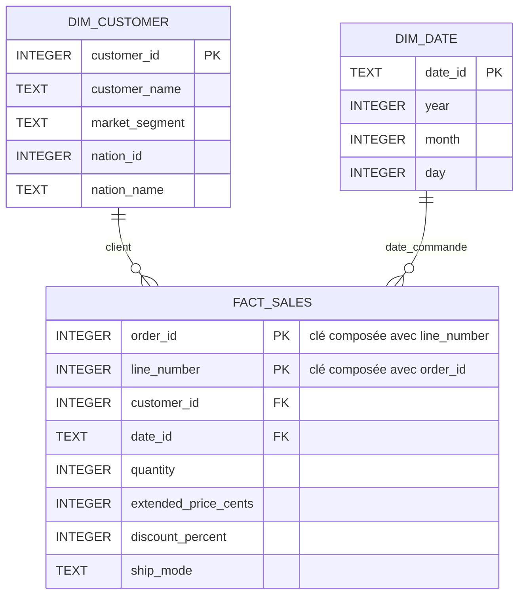

# Étape 3 — Règles métier et schéma en étoile

Ce document fixe les règles retenues le 04/11/2026 pour le parcours Junior/Mid, à partir de l'énoncé `README.md`.
Il constitue la spécification du chargement et des rapports. Le chargement initial des tables sources est réalisé à l'étape 4 (voir `README_ETAPE_4.md`) ; les dimensions et les faits sont réalisés à l'étape 5 (voir `README_ETAPE_5.md`). Le rapport mensuel est réalisé à l'étape 6 (voir `README_ETAPE_6.md`) ; NATION et les cinq analyses métier sont réalisés à l'étape 7 (voir `README_ETAPE_7.md`).

## 1. Où en est le projet ?

L'environnement Python est prêt et les fichiers ont été explorés.
On connaît maintenant les colonnes, les volumes et les relations principales.

On va commencer avec trois fichiers :

| Fichier | Ce qu'il contient | Exemple |
| --- | --- | --- |
| `customer.tbl` | Les clients | Le client 12, son nom et son segment |
| `orders.tbl` | Les commandes | La commande 100 passée par le client 12 |
| `lineitem.tbl` | Les lignes de commande | Deux articles différents dans la commande 100 |

Un client peut avoir plusieurs commandes. Une commande peut contenir plusieurs lignes.

L'objectif du premier rapport sera de répondre à une question simple : **quel montant de ventes a-t-on par mois ?**

## 2. Qu'est-ce qu'une règle métier ?

Une règle métier explique comment interpréter et calculer une information.
Elle doit être claire avant d'écrire le code.

Par exemple, « ventes par mois » laisse plusieurs questions ouvertes :

- Quel montant additionner ?
- Faut-il prendre en compte la remise ?
- Quelle date détermine le mois : commande ou livraison ?
- Comment arrondir les montants ?

Deux personnes peuvent obtenir des résultats différents si elles utilisent des règles différentes.
On écrit donc nos choix pour que le rapport puisse être compris et reproduit.

## 3. Quel montant va-t-on mesurer ?

Choix retenu : utiliser le montant des lignes de commande après remise, hors taxe.
Il s'agit ici d'une mesure d'analyse des commandes ; on ne définit pas de règle comptable de reconnaissance du revenu.
Toutes les lignes sont incluses, quels que soient le statut de commande et l'indicateur de retour. Aucun filtre sur ces champs n'est demandé dans l'énoncé. Les résultats décrivent donc les commandes du jeu de données, pas un chiffre d'affaires comptable encaissé.

Les colonnes utiles sont :

| Colonne source | Signification |
| --- | --- |
| `L_QUANTITY` | La quantité de la ligne |
| `L_EXTENDEDPRICE` | Le prix total de la ligne avant remise et taxe |
| `L_DISCOUNT` | Le taux de remise : `0.10` signifie 10 % |
| `L_TAX` | Le taux de taxe, non utilisé dans cette mesure hors taxe |

Le calcul retenu est :

```text
Montant après remise = L_EXTENDEDPRICE × (1 − L_DISCOUNT)
```

Exemple :

```text
Quantité : 2
Prix total de la ligne : 100,00
Remise : 10 %

Montant après remise = 100,00 × (1 − 0,10) = 90,00
```

`L_EXTENDEDPRICE` inclut déjà la quantité. On ne multiplie donc pas encore ce prix par 2.

Pour le socle, ce montant sera calculé dans les requêtes des rapports, à partir du prix et de la remise conservés dans les faits.
L'ajout d'une colonne persistée de revenu par ligne, demandé en bonus, reste reporté.

**Arrondi retenu :** arrondir chaque montant de ligne au centime avec `ROUND_HALF_UP`, puis additionner les montants arrondis. Pour ces montants positifs, un demi-centime est arrondi au centime supérieur.

Exemple : `10,05 × (1 − 0,10) = 9,045`, arrondi à **9,05**.
Deux lignes de `0,05` avec 10 % de remise donnent chacune `0,045`, soit `0,05` après arrondi : leur somme vaut `0,10`. Arrondir uniquement leur somme avant arrondi donnerait `0,09` et ne respecte pas notre règle.

Les montants sources seront lus avec `Decimal`, puis convertis exactement en centimes entiers. La remise sera un pourcentage entier : `0.10` devient `10`. Une valeur non représentable exactement dans ces unités sera rejetée, sans troncature ni arrondi silencieux.

Pour calculer le montant après remise en SQL sans flottant, on utilisera l'expression entière suivante, valable pour les prix non négatifs et les remises entières de 0 à 100 :

```sql
(extended_price_cents * (100 - discount_percent) + 50) / 100
```

Dans SQLite, les opérandes de cette expression seront des entiers. Le résultat est le montant arrondi en centimes ; `SUM` portera sur cette expression. La conversion en unité monétaire sera réservée à l'affichage. Les valeurs et totaux devront rester dans la capacité des entiers SQLite ; un dépassement fera échouer le traitement au lieu de produire un calcul flottant.

## 4. Quelle date va-t-on utiliser ?

Choix retenu : utiliser `O_ORDERDATE`, la date de commande.

Si une commande est passée le 20 janvier et livrée le 5 février, ses lignes seront comptées dans les ventes de janvier.

Pour regrouper les mois, on utilisera **l'année et le mois**. Ainsi, janvier 1995 et janvier 1996 restent deux périodes différentes.

Les données sont historiques : les commandes vont de 1992 à 1998.
Le premier rapport utilisera ces dates telles qu'elles sont. La modification des dates sur les deux dernières années reste un bonus.

**Comparaison retenue :** comparer le mois civil précédant celui de la date de commande maximale au mois civil encore précédent. On exclut systématiquement le mois de la date maximale, dont la complétude n'est pas garantie, sans se baser sur la date du jour.

Pour les fichiers fournis, la date maximale est le **02/08/1998** : la période courante sera **juillet 1998**, comparée à **juin 1998**. Ce choix suppose que les mois antérieurs au dernier mois du jeu sont complets ; les seuls fichiers ne permettent pas de certifier la complétude du système source.

Chaque période sera filtrée avec une borne de début incluse et une borne de fin exclue : juillet correspond à `date_id >= '1998-07-01' AND date_id < '1998-08-01'`.

- Écart absolu : `revenu_courant − revenu_precedent`.
- Variation en pourcentage : `100 × (revenu_courant − revenu_precedent) / revenu_precedent`, avec calcul décimal pour ce ratio et affichage à deux décimales.
- Si une des périodes n'a aucune ligne, afficher un revenu `NULL` pour cette période et des variations `NULL`, avec la mention « période absente ». Ne pas remplacer une période absente par un autre mois.
- Si le revenu précédent est nul mais la période présente, calculer l'écart absolu et afficher une variation en pourcentage `NULL`, avec la mention « base précédente nulle ».

Le rapport mensuel initial conservera tous les mois présents, y compris août 1998, identifié comme potentiellement partiel. L'exclusion du dernier mois s'applique à la comparaison de périodes.

## 5. Qu'est-ce qu'un schéma en étoile ?

C'est une organisation des tables pour faciliter les analyses.
Une table centrale contient les événements et les nombres à additionner. Des tables autour décrivent ces événements.

On distingue deux notions :

| Notion | Rôle | Exemple dans ce projet |
| --- | --- | --- |
| Table de faits | Contenir les lignes à analyser et leurs mesures | Quantité et prix d'une ligne de commande |
| Dimension | Décrire le contexte d'une ligne | Le client ou la date |

Une **mesure** est une valeur qu'on souhaite analyser, par exemple une quantité ou un montant.

Modèle retenu :



Chaque ligne de `FACT_SALES` est liée à un client et à une date.
Un même client ou une même date peut correspondre à plusieurs lignes de faits.

## 6. Que représente une ligne de la table de faits ?

On appelle cela le **grain** de la table.

Choix retenu : **une ligne de faits représente une ligne de commande**.

| Commande | Numéro de ligne | Client | Quantité | Prix avant remise |
| --- | --- | --- | --- | --- |
| 100 | 1 | 12 | 2 | 100,00 |
| 100 | 2 | 12 | 1 | 50,00 |

La commande 100 produit deux lignes de faits.
Le couple `(commande, numéro de ligne)` identifie chaque ligne sans ambiguïté.

Pourquoi garder ce détail ? On peut ensuite additionner les lignes par client, par mois ou par mode de transport.

Le total de la commande ne doit pas être répété puis additionné pour chaque ligne : cela compterait plusieurs fois le même montant.

## 7. Quelles tables va-t-on préparer ?

Les noms et colonnes ci-dessous définissent le modèle cible, maintenant créé et alimenté dans SQLite à l'étape 5. Toutes les colonnes sont obligatoires ; les identifiants entiers primaires utilisent la contrainte `INTEGER PRIMARY KEY` de SQLite.

### `dim_customer` — Décrire les clients

| Colonne retenue | Origine | Utilité |
| --- | --- | --- |
| `customer_id` | `C_CUSTKEY` | Identifier le client |
| `customer_name` | `C_NAME` | Afficher son nom |
| `market_segment` | `C_MKTSEGMENT` | Regrouper les clients par segment |
| `nation_id` | `C_NATIONKEY` | Identifier le pays du client |
| `nation_name` | `N_NAME`, via NATION | Afficher le pays du client (ajout à l'étape 7) |

Pour ce petit projet, on reprend la clé client de la source comme clé primaire entière.
On garde également les clients sans commande dans cette dimension.
Le nom du pays est ajouté depuis l'intégration de NATION à l'étape 7.
La dimension reflétera le contenu du fichier courant à chaque rechargement, sans conserver l'historique des changements de client.

### `dim_date` — Décrire les dates

| Colonne retenue | Exemple | Utilité |
| --- | --- | --- |
| `date_id` | `1996-01-20` | Identifier la date, sous forme de texte ISO |
| `year` | `1996` | Regrouper par année |
| `month` | `1` | Regrouper par mois avec l'année |
| `day` | `20` | Identifier le jour du mois |

Cette dimension contiendra tous les jours entre la date de commande minimale et la date maximale, bornes incluses, même les jours sans commande. Elle permettra de disposer d'un calendrier continu.
Sa clé primaire sera un texte ISO `AAAA-MM-JJ` unique, validé en Python ; les colonnes `year`, `month` et `day` seront des entiers cohérents avec cette date.

### `fact_sales` — Contenir les lignes à analyser

| Colonne retenue | Origine | Utilité |
| --- | --- | --- |
| `order_id` | `L_ORDERKEY` | Retrouver la commande |
| `line_number` | `L_LINENUMBER` | Identifier la ligne dans la commande |
| `customer_id` | `O_CUSTKEY`, via ORDERS | Relier le fait au client |
| `date_id` | `O_ORDERDATE`, via ORDERS | Relier le fait à la date |
| `quantity` | `L_QUANTITY` | Analyser les quantités |
| `extended_price_cents` | `L_EXTENDEDPRICE` converti en centimes | Conserver le prix avant remise |
| `discount_percent` | `L_DISCOUNT` multiplié par 100 | Conserver la remise entière : `0.10` devient `10` |
| `ship_mode` | `L_SHIPMODE` | Regrouper les lignes par transport |

Le prix en centimes évite de stocker les montants sources avec une représentation flottante approximative : `100,25` devient l'entier `10025`.
Le calcul après remise respectera la règle d'arrondi définie en section 3.

Une **clé primaire** identifie une ligne de façon unique. Une **clé étrangère** référence une ligne d'une autre table.
Ici, la clé primaire des faits sera le couple `(order_id, line_number)`. Les clés étrangères `customer_id` et `date_id` pointeront vers les dimensions.
`nation_id` et `nation_name` sont des attributs de la dimension client. Depuis l'étape 7, la référence pays est contrôlée dans les sources par CUSTOMER → NATION, puis recopiée dans la dimension.

Les identifiants de commande, de client et les numéros de ligne seront des entiers positifs. Le code pays peut valoir zéro, comme dans les fichiers fournis. Les faits imposeront `quantity > 0`, `extended_price_cents >= 0` et `discount_percent BETWEEN 0 AND 100`. Le mode de transport restera du texte non vide, sans nouvelle dimension pour ce petit périmètre.

Les mesures additives seront la quantité, le prix avant remise et le montant après remise arrondi. Le taux de remise ne s'additionne pas ; `O_TOTALPRICE` ne sera pas recopié dans les faits.

## 8. Quel chemin suivront les données ?

```text
Fichiers .tbl
    ↓ lecture Python
Tables sources SQLite : NATION, CUSTOMER, ORDERS, LINEITEM
    ↓ transformations
Dimensions : dim_customer et dim_date
    ↓ alimentation
Table de faits : fact_sales
    ↓ requête SQL
Rapport : montant des ventes par année et mois
```

Les tables sources gardent les informations proches des fichiers.
Les tables du modèle en étoile organisent les données pour les rapports.

Pour chaque ligne de LINEITEM, on retrouve sa commande dans ORDERS afin de connaître le client et la date.
On crée les dimensions avant de charger les faits, car les faits ont besoin de leurs clés.

## 9. Que fera-t-on si le chargement échoue ou est relancé ?

Les comportements retenus sont les suivants :

- **Lecture invalide :** arrêter le chargement si un fichier est absent ou vide, si le nombre de champs est incorrect, si un champ obligatoire est vide ou si une conversion échoue. Indiquer le fichier, le numéro de ligne lorsque disponible, la colonne et la cause. Retirer uniquement le champ vide supplémentaire dû au séparateur final.
- **Valeur invalide :** rejeter les dates inexistantes, les nombres non finis, les quantités non entières ou non positives, les prix de vente négatifs et les remises ou taxes hors de `[0, 1]`. Conserver les soldes clients négatifs et les retards de livraison : ils ne constituent pas à eux seuls des erreurs.
- **Intégrité :** refuser les clés répétées, même si les lignes sont identiques, ainsi que les clients sans pays, les commandes sans client et les lignes sans commande. Ne pas ignorer silencieusement ces lignes.
- **Contraintes sources :** contrôler la chaîne NATION → CUSTOMER → ORDERS → LINEITEM depuis l'étape 7. Les codes région, produit et fournisseur restent conservés sans référence vers des tables absentes. Le DDL complet de l'énoncé sert de référence et est adapté au périmètre ; activer `PRAGMA foreign_keys = ON` sur chaque connexion d'écriture, avant la transaction.
- **Conversions sources :** stocker les montants en centimes entiers, les remises et taxes en pourcentages entiers et les dates en texte ISO. Conserver les téléphones et les commentaires comme texte. Le parseur vérifiera la précision avant toute conversion entière.
- **Relance :** effectuer un rechargement complet des seules tables générées du projet, dans une base SQLite dédiée. Supprimer les données enfants avant les parents, puis recharger les parents avant les enfants. La base ne sera pas supprimée du disque.
- **Atomicité :** regrouper le remplacement des sources, des dimensions et des faits dans une même transaction, comme réalisé à l'étape 5. Une erreur annulera toutes les écritures de cette exécution ; la dernière version validée restera disponible. Ne publier les rapports qu'après validation de la transaction.

Une **transaction** regroupe des écritures : elles sont validées ensemble, ou annulées ensemble en cas d'erreur.
Le résultat attendu après une relance est le même nombre de lignes et les mêmes montants.

## 10. Quelles règles appliquer aux cinq analyses ?

Ces choix sont appliqués par les vues de l'étape 7, définies dans `sql/04_business_reports.sql`.

| Analyse de l'énoncé | Règle retenue |
| --- | --- |
| Top 5 des pays par revenu | Pays du client, obtenu par CUSTOMER → NATION ; somme des montants après remise arrondis, tri décroissant. En cas d'égalité, trier par code pays croissant pour retenir exactement cinq pays. |
| Transport le plus fréquent parmi ces pays | Compter globalement les lignes de commande de ces cinq pays par `ship_mode`, sans pondérer par la quantité ou le revenu. Retourner tous les modes ex æquo au premier rang. |
| Meilleurs mois | Classer les périodes année-mois par revenu décroissant ; afficher les mois présents et signaler le dernier mois potentiellement partiel. En cas d'égalité, trier chronologiquement. |
| Meilleurs clients | Fournir deux classements : revenu décroissant et quantité totale décroissante, avec identifiant client croissant en cas d'égalité. |
| Période courante contre précédente | Appliquer les mois, formules et cas particuliers de la section 4. |

L'ajout de NATION enrichit `dim_customer` avec `nation_name`, sans changer le grain des faits. Pour ce jeu issu d'une même génération, les montants sont agrégés tels que fournis ; aucune conversion de devise n'est définie par les fichiers ni par l'énoncé.

## 11. Comment vérifier l'implémentation ?

- Comparer les volumes sources aux fichiers : 25 pays, 1 500 clients, 15 000 commandes et 60 175 lignes pour le jeu fourni. Ces valeurs sont des références de vérification, pas des limites à coder dans le parseur.
- Conserver tous les clients, y compris les 500 sans commande observés dans le jeu fourni.
- Vérifier que chaque ligne source donne exactement un fait et que les quantités ainsi que les prix avant remise sont conservés après transformation.
- Vérifier les calculs sur les exemples de la section 3, notamment les demi-centimes et la somme des montants arrondis.
- Vérifier les clés primaires, les clés étrangères et la continuité du calendrier ; le chargement final doit avoir autant de faits que de lignes de commande.
- Relancer avec les mêmes fichiers et comparer les volumes et les agrégats.
- Provoquer une erreur sur un petit jeu de vérification et vérifier que la version précédente de la base reste intacte.
- Vérifier les périodes absentes et les revenus précédents nuls lors de l'écriture du rapport comparatif.

Les vérifications du chargement, des faits, du calendrier, des arrondis et des relances sont des tests exécutables. Les cas propres aux classements et à la comparaison de périodes sont également testés depuis l'étape 7.

## 12. Dans quel ordre va-t-on travailler ?

1. Étape 4 réalisée : tables sources SQLite et chargement des trois fichiers.
2. Contrôles réalisés à l'étape 4 : volumes, conversions, relations et relance ; tests et instructions dans `README_ETAPE_4.md`.
3. Étape 5 réalisée : dimensions et faits chargés dans la même transaction que les sources ; contrôles et instructions dans `README_ETAPE_5.md`.
4. Étape 6 réalisée : vue `monthly_sales`, tests et instructions dans `README_ETAPE_6.md`.
5. Étape 7 réalisée : NATION, cinq analyses, tests et exports CSV ; instructions dans `README_ETAPE_7.md`.

Le livrable de l'étape 3 est **un modèle documenté avec des règles précises**. L'exploitation et l'architecture sont maintenant documentées dans `README_ETAPE_9.md`, et la validation depuis zéro dans `VALIDATION_FINALE.md`. Le suivi `todo` distingue le travail local terminé et la publication GitHub restante.

Les bonus restent pour après le socle Junior/Mid : Docker, streaming, génération de données, classification des soldes, changement des dates et profilage supplémentaire.
