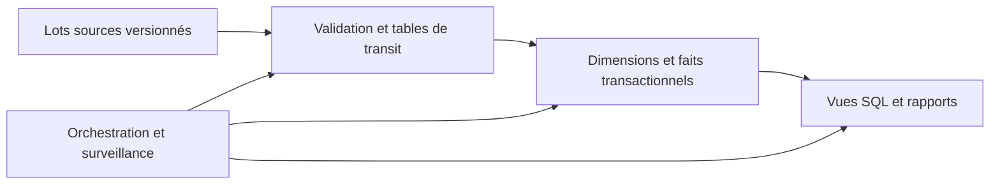

# Étape 9 — Exploitation, déploiement et architecture

Ce document répond aux questions de planification, de déploiement et de croissance de l'énoncé. Le périmètre livré reste une application Python et SQL sur une machine Linux, avec SQLite et Datasette.

## 1. Exécuter plusieurs fois par jour

Le lanceur [`scripts/run_pipeline.sh`](../scripts/run_pipeline.sh) enchaîne le chargement et l'export. Il utilise le Python de `.venv`, retrouve la racine du projet et écrit dans un journal quotidien. Il fonctionne aussi depuis un autre dossier :

```bash
bash scripts/run_pipeline.sh
```

Pour planifier quatre exécutions quotidiennes, ouvrir `crontab -e` sous le compte qui possède le projet, puis ajouter la ligne suivante **après avoir adapté le chemin absolu** :

```cron
0 0,6,12,18 * * * /bin/bash /srv/dataengineer_test/scripts/run_pipeline.sh
```

Cela lance le traitement à 00 h, 06 h, 12 h et 18 h dans le fuseau utilisé par le service cron. Vérifier l'heure et le fuseau de la machine avant installation. Les heures inexistantes ou répétées lors des changements d'heure peuvent affecter les lancements ; si un intervalle strict est requis, fixer et documenter un fuseau UTC pour l'hôte d'exécution. Le format des cinq champs est décrit dans le [manuel crontab](https://www.man7.org/linux/man-pages/man5/crontab.5.html).

Le projet fournit la commande à planifier ; aucune crontab n'est installée automatiquement. L'activation interactive de `.venv` n'est pas nécessaire dans cron : le lanceur utilise son interpréteur par chemin explicite. Vérifier que cron est installé et actif sur la machine cible.

## 2. Chemins, verrous et journaux

| Variable facultative | Valeur par défaut |
| --- | --- |
| `PIPELINE_PYTHON` | `.venv/bin/python` dans le projet |
| `PIPELINE_DATA_DIR` | `data/` dans le projet |
| `PIPELINE_OUTPUT_DIR` | `outputs/` dans le projet |
| `PIPELINE_DATABASE` | `warehouse.sqlite` dans le dossier de sortie |
| `PIPELINE_LOG_DIR` | `logs/` dans le projet |

Pour personnaliser ces variables, utiliser des chemins absolus. Une configuration doit avoir son propre dossier de sorties. Par exemple, depuis la racine du projet :

```bash
PIPELINE_DATA_DIR=/srv/dataengineer_inputs/lot_valide \
PIPELINE_OUTPUT_DIR=/srv/dataengineer_results \
PIPELINE_LOG_DIR=/srv/dataengineer_logs \
bash scripts/run_pipeline.sh
```

Le verrou est placé à côté de la base, avec le suffixe `.pipeline.lock`. Il couvre le chargement **et** l'export. Une deuxième exécution utilisant la même base et le même chemin de verrou termine immédiatement avec le code `75`, sans charger ni exporter. Le verrou est libéré par le système à la fermeture du processus ; conserver le fichier sur disque et ne pas le supprimer pour tenter de débloquer une exécution. Ce comportement utilise [`flock -n -E`](https://man7.org/linux/man-pages/man1/flock.1.html).

Toutes les exécutions planifiées doivent passer par le lanceur : les commandes Python exécutées directement ne prennent pas ce verrou. Pour une base existante, utiliser le même chemin absolu canonique, sans alias symboliques concurrents.

Le lanceur affiche le chemin du journal, puis écrit les volumes, les exports et les marqueurs `DÉBUT`, `SUCCÈS`, `ÉCHEC` ou `IGNORÉ` dans `logs/pipeline-AAAA-MM-JJ.log`. Le code `0` signifie que le chargement et l'export ont réussi ; `75` signale le verrou occupé ; les autres codes signalent une erreur. Une erreur de chargement arrête le lanceur avant l'export.

Prévoir une surveillance de la dernière exécution réussie, des codes de sortie et de l'espace disque. Un journal local seul n'envoie aucune alerte. En exploitation, centraliser les journaux et fixer une rétention, par exemple 30 jours, selon les besoins du service.

## 3. Arrivée des fichiers et reprise après échec

Les quatre fichiers constituent un **instantané complet** à recharger : `nation.tbl`, `customer.tbl`, `orders.tbl` et `lineitem.tbl`. Un fichier contenant uniquement les nouvelles lignes remplacerait les données précédentes ; le chargeur actuel n'est pas incrémental.

Le producteur doit préparer un lot dans un dossier séparé, terminer toutes les écritures, puis le rendre disponible comme lot complet avant le lancement. Les fichiers ne doivent pas être modifiés pendant leur lecture. Pour une production, ajouter un manifeste avec identifiant de lot, tailles et empreintes, puis conserver le lot brut validé pour permettre une relance identique. Ce protocole d'arrivée est une recommandation ; il n'est pas automatisé par le chargeur actuel.

En cas d'erreur de lecture ou de contrôle, la transaction SQLite annule les écritures et conserve la dernière base validée. Corriger ou remplacer le lot, puis relancer la même commande. Le code ne rejette pas silencieusement les lignes invalides. Pour des lots erronés répétés, faire intervenir le producteur plutôt que relancer sans limite.

Si le chargement réussit mais que l'export échoue, la nouvelle base est déjà validée. Corriger la destination ou le manque d'espace, puis relancer `python -m etl.export_reports`. Les CSV sont des copies ; leur écriture en sept fichiers n'est pas une publication atomique de l'ensemble. Consommer un export seulement après le succès du lanceur ; pour une publication partagée en production, écrire dans un dossier de version puis basculer un pointeur une fois les sept fichiers vérifiés.

## 4. Déployer sur une autre machine Linux

Prérequis : Python 3.12, module `venv`, SQLite embarqué version 3.37 ou supérieure, Bash et `flock` de util-linux. L'accès au registre Python est nécessaire pour installer les dépendances. Datasette et pytest sont enregistrés avec leurs versions dans `requirements.txt` ; le chargement et l'export utilisent uniquement la bibliothèque standard.

1. Copier ou cloner le projet dans un dossier appartenant au compte de service, par exemple `/srv/dataengineer_test`. Ne pas copier l'ancien `.venv` ; les environnements virtuels se recréent sur la cible.
2. Depuis ce dossier, exécuter :

```bash
python3.12 -m venv .venv
.venv/bin/python -m pip install -r requirements.txt
.venv/bin/python -m pip check
.venv/bin/python -c 'import sqlite3; print(sqlite3.sqlite_version); assert sqlite3.sqlite_version_info >= (3, 37, 0)'
.venv/bin/python -m pytest -q tests
bash scripts/run_pipeline.sh
```

3. Vérifier le journal, les sept CSV et la base avant d'installer la ligne cron. Le compte doit pouvoir lire le code et les sources, puis écrire les sorties, journaux et fichiers de verrouillage. Aucune exécution en administrateur n'est nécessaire pour le pipeline.
4. Pour consulter les résultats sur la machine cible :

```bash
.venv/bin/datasette serve outputs/warehouse.sqlite --host 127.0.0.1 --port 8001
```

Ouvrir `http://127.0.0.1:8001/warehouse`. Depuis une autre machine, un tunnel SSH peut donner accès à cette adresse locale. Pour une consultation permanente partagée, prévoir un service supervisé, un contrôle d'accès et un proxy TLS ; ils ne sont pas installés par ce livrable.

Conserver le code et les données sur un disque local pour cette architecture. SQLite permet plusieurs lecteurs mais un seul écrivain à la fois, et sa documentation déconseille le partage direct du fichier par plusieurs machines sur un système de fichiers réseau. Ces limites motivent une base client/serveur si la concurrence augmente. Voir les [cas d'usage de SQLite](https://www.sqlite.org/whentouse.html).

## 5. Sauvegarde et mises à jour

Conserver les lots sources et une version du code permet de reconstruire le résultat. Pour sauvegarder aussi la dernière base validée, utiliser l'API SQLite de sauvegarde plutôt qu'une copie arbitraire pendant une écriture. Exemple depuis la racine, avec une destination choisie pour la sauvegarde :

```python
import sqlite3
from contextlib import closing

with closing(sqlite3.connect("file:outputs/warehouse.sqlite?mode=ro", uri=True)) as source:
    with closing(sqlite3.connect("outputs/warehouse-backup.sqlite")) as destination:
        source.backup(destination)
```

La méthode est documentée dans la [bibliothèque standard Python](https://docs.python.org/3.12/library/sqlite3.html#sqlite3.Connection.backup). Prévoir la rétention et vérifier une restauration dans un dossier séparé avant d'en dépendre.

Pour mettre à jour le code, suspendre les lancements planifiés, sauvegarder, installer la version choisie, recréer les dépendances si elles ont changé, exécuter les tests et lancer un traitement contrôlé avant de réactiver la planification. Les migrations des versions 1 et 2 vers 3 sont prises en charge. Une modification future de structure nécessite une nouvelle migration ; revenir à un ancien code seul ne remet pas automatiquement une ancienne structure de base.

## 6. Architecture pour une production

Pour le volume de l'exercice et un producteur unique, conserver Python, SQLite et cron simplifie l'exploitation. La décision d'évoluer doit reposer sur le volume absolu, les durées mesurées, la concurrence et le délai de fraîcheur attendu.

Une évolution possible conserve les règles métier et sépare les responsabilités :



Pour plusieurs utilisateurs et traitements concurrents, je proposerais PostgreSQL, avec des tables de transit, des contraintes et des transactions. Son mécanisme [`COPY`](https://www.postgresql.org/docs/current/sql-copy.html) peut charger les données en masse. La migration doit adapter et tester le SQL propre à SQLite, notamment `STRICT`, `printf`, les dates et les métadonnées ; remplacer seulement le connecteur ne suffit pas.

Quand le rechargement complet dépasse la fenêtre disponible, introduire un identifiant de lot et un chargement incrémental fondé sur des clés stables, des dates de modification ou une capture des changements. Définir avant cela le traitement des corrections et suppressions ; un filtre sur la seule date de commande ne détecte pas toutes les modifications. Adapter l'historisation des dimensions si les rapports doivent conserver le pays ou le segment au moment de chaque vente.

Si plusieurs pipelines ont des dépendances et des besoins de reprise, Airflow peut remplacer cron. Les tâches devront rester relançables sans doublon et utiliser un lot déterminé, conformément aux [bonnes pratiques Airflow](https://airflow.apache.org/docs/apache-airflow/stable/best-practices.html). Ajouter des contrôles de qualité avant publication, des métriques de durée, de volume, de fraîcheur, des alertes et des sauvegardes restaurables. L'infrastructure de production n'est pas déployée dans ce test.

## 7. Croissance mensuelle de 6,1 à 12,7 %

Une croissance composée suit la formule `V(t) = V0 × (1 + r)^t`, où `t` est le nombre de mois. En prenant les 60 175 lignes de commande comme point de départ :

| Horizon | Facteur à 6,1 % | Lignes estimées | Facteur à 12,7 % | Lignes estimées |
| --- | ---: | ---: | ---: | ---: |
| 6 mois | × 1,43 | 85 844 | × 2,05 | 123 299 |
| 12 mois | × 2,04 | 122 462 | × 4,20 | 252 641 |
| 24 mois | × 4,14 | 249 221 | × 17,63 | 1 060 694 |

Le volume double en environ 11,7 mois au taux bas et 5,8 mois au taux haut. Ce sont des projections à taux constant, pas une prévision issue des fichiers.

Ce taux ne rend pas immédiatement le système inutilisable, mais augmente le coût du rechargement complet à chaque exécution. Le stockage comprend les sources, les tables, les index, le journal transactionnel, les sauvegardes et les exports. Les agrégations et tris peuvent aussi croître autrement que linéairement ; mesurer les durées et l'espace maximal au lieu de les déduire uniquement du nombre de lignes.

Surveiller la durée des étapes, les conflits de verrou, l'espace disque disponible, les volumes attendus et l'âge de la dernière exécution réussie. Fixer un objectif de fraîcheur et une marge dans la fenêtre de traitement. Si cette marge disparaît, optimiser les insertions par lots et les requêtes, puis évaluer l'incrémental et une base client/serveur. Le partitionnement ne se décide qu'après examen des requêtes et des plans d'exécution.

## 8. Limites et bonus

Le livrable réalise un rechargement complet sur un hôte unique. Il n'installe pas de service cron, de plateforme distribuée ou de publication sécurisée de Datasette. Docker, le streaming, la génération de nouvelles données, la classification des soldes et le déplacement des dates restent des bonus reportés. Le revenu par ligne est calculé dans les requêtes, sans nouvelle colonne persistée de revenu.

L'exploration initiale est conservée dans `docs/exploration_donnees.md` : format, types, doublons, références, dates et catégories. Ces résultats ont motivé la clé composée des faits, les centimes entiers, la conservation des soldes négatifs et le signalement du dernier mois potentiellement incomplet.
