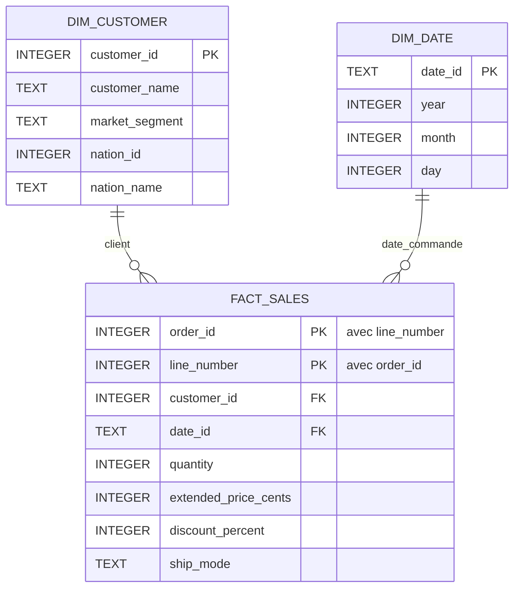

# Modèle de données et règles métier

## Sources et format

Les fichiers TPC-H fournis sont du texte ASCII sans en-tête, séparé par `|`, avec un séparateur final. Les nombres utilisent le point décimal et les dates le format `AAAA-MM-JJ`. Le lecteur accepte aussi les lignes sans séparateur final ; il retire uniquement le champ vide supplémentaire attendu.

| Source chargée | Clé | Lignes du jeu fourni |
| --- | --- | ---: |
| NATION | `N_NATIONKEY` | 25 |
| CUSTOMER | `C_CUSTKEY` | 1 500 |
| ORDERS | `O_ORDERKEY` | 15 000 |
| LINEITEM | `(L_ORDERKEY, L_LINENUMBER)` | 60 175 |

L'ordre de chargement est NATION → CUSTOMER → ORDERS → LINEITEM. Les références pays, client et commande sont contrôlées par clés étrangères. Les codes région, produit et fournisseur restent conservés sans référence vers des tables non chargées.

Le [DDL original](../ddl.sql) et l'[ERD fourni](../erd.png) sont conservés. Les définitions réellement exécutées sont dans [`sql/01_sources.sql`](../sql/01_sources.sql) et [`sql/02_star_schema.sql`](../sql/02_star_schema.sql). La clé composée de LINEITEM évite de confondre plusieurs lignes d'une même commande.

## Schéma en étoile



Le grain est **une ligne de commande**. Pour chaque ligne de LINEITEM, la jointure à ORDERS apporte le client et la date de commande. `fact_sales` contient 60 175 lignes ; le total de commande n'est pas recopié dans les faits.

`dim_customer` reprend les clés sources et conserve les 1 500 clients, dont 500 sans commande. Le pays est celui du client, enrichi depuis NATION. Les attributs reflètent le lot courant, sans historique des changements de client.

`dim_date` contient tous les jours entre la première et la dernière commande, y compris les jours sans vente : 2 406 dates du 01/01/1992 au 02/08/1998.

## Montants et revenu

Les montants sont lus avec `Decimal`, puis stockés en centimes entiers. Les remises et taxes sont des pourcentages entiers : `12.34` devient `1234` centimes et `0.10` devient `10` pour cent. Une précision supplémentaire non représentable dans ces unités est refusée.

Le revenu retenu est le prix étendu après remise, hors taxe. Le prix étendu inclut déjà la quantité. Chaque ligne est arrondie au centime avec `ROUND_HALF_UP`, puis les montants arrondis sont additionnés :

```sql
SUM((extended_price_cents * (100 - discount_percent) + 50) / 100)
```

Avec des opérandes entiers et des prix non négatifs, la division entière réalise cet arrondi. `10,05 × 90 %` donne `9,045`, soit `9,05`. Deux lignes de `0,05` avec 10 % de remise donnent ensemble `0,10` après arrondi de chaque ligne. Le chargeur refuse les dépassements de capacité avant le calcul.

Tous les statuts et indicateurs de retour sont inclus. La mesure décrit les commandes du jeu, pas un revenu comptable encaissé. Aucune devise ni conversion de devise n'est définie par les sources. Le revenu est calculé dans les vues, sans colonne persistée supplémentaire.

## Dates et classements

Les ventes utilisent la **date de commande**, regroupée par année et mois. Le dernier mois est conservé avec la note « potentiellement partiel ».

La comparaison prend les deux mois précédant celui de la date maximale du jeu : juillet 1998 contre juin 1998. Elle ne dépend pas de la date du jour et suppose que les mois antérieurs sont complets. Une période sans ligne reste `NULL` ; une période présente à revenu nul reste zéro.

Les pays sont classés par revenu décroissant, puis par code pour retenir exactement cinq pays au maximum. Le transport est compté globalement par nombre de lignes de ces pays, avec tous les modes ex æquo au premier rang. Les mois sont départagés chronologiquement ; les clients par identifiant croissant. Les [requêtes et résultats](resultats.md) détaillent les cinq analyses.

## Contrôles et relance

Le chargement remplace complètement les sept tables du projet dans une seule transaction. Il refuse les fichiers absents ou vides, les structures incorrectes, les champs obligatoires vides, les conversions invalides, les doublons et les références absentes. Les quantités doivent être positives, les prix de vente non négatifs et les remises et taxes compris entre 0 et 100 %.

Une erreur restaure la dernière version validée. Une relance du même lot conserve les mêmes données et agrégats. La base est identifiée par les métadonnées SQLite du projet ; les versions 1 et 2 sont migrées vers 3, tandis qu'une base étrangère ou une version inconnue est refusée.

Les tests comparent les volumes, les quantités et les prix des sources et des faits. Ils calculent aussi les revenus indépendamment depuis les fichiers, avec `Decimal`, et vérifient les relances et l'annulation des migrations.

## Profilage et décisions de conception

Le [notebook d'exploration](../notebooks/01_data_exploration.ipynb) accompagne le jeu fourni. L'exploration initiale a lu les huit fichiers, soit 86 805 lignes, avec `csv`, `Decimal` et des compteurs Python. Elle ne relève ni champ vide, ni doublon de clé, ni référence orpheline sur les relations explorées.

Les observations ont guidé le modèle : 500 clients sans commande sont conservés ; 139 soldes négatifs sont acceptés ; les retards de réception ne sont pas rejetés ; les dates historiques sont gardées. La précision des montants et le séparateur final sont traités explicitement. Les contrôles du pipeline portent sur les quatre tables effectivement chargées.
